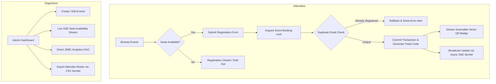

# 🎟️ EventHub — Centralized Event Management System

[](https://openjdk.org/)
[](https://spring.io/projects/spring-boot)
[](https://jakarta.ee/specifications/servlet/)
[](https://docs.oracle.com/javase/tutorial/jdbc/)
[](https://www.mysql.com/)
[](LICENSE)

A high-performance, full-stack web platform built with **Java 21**, **Spring Boot 3**, **Jakarta Servlet API 6.0**, and **Direct JDBC**, designed to unify event planning, attendee registration, live capacity tracking, and participant management into one centralized system.

---

## 📌 Problem Statement

Managing events through fragmented Google Forms, direct messaging channels, and manual spreadsheets presents significant operational challenges:
* ⚠️ **Duplicate Registrations:** Attendees register multiple times, inflating headcounts and skewing planning metrics.
* ⚠️ **Communication Gaps & Lost Tickets:** Participants lack immediate, verifiable admission passes or lookup tools.
* ⚠️ **Accidental Overbooking:** Manual sign-up forms cannot enforce live seat capacity constraints under concurrent traffic.
* ⚠️ **Inefficient Participant Tracking:** Organizers struggle to retrieve rosters, inspect remaining seats, or manage cancellations centrally.

---

## 💡 The Solution

**EventHub** replaces ad-hoc forms with an enterprise-grade web platform:
1. **Centralized Event Portal:** Attendees discover events, search by keyword, filter by category, and view real-time seat availability.
2. **Duplicate Prevention Engine:** Enforces case-insensitive email uniqueness per event at both the service layer (`existsByEventIdAndEmailIgnoreCase`) and database layer (`UNIQUE KEY uq_event_email`).
3. **Live Seat & Capacity Controls:** Real-time capacity validation prevents registrations once an event is sold out, complete with visual utilization progress bars and Server-Sent Events (SSE).
4. **Unique Admission Pass Generation:** Generates tamper-resistant ticket codes (`EVT-2026-XXXXX`) with printable e-passes and instant online reference lookup.
5. **Organizer Control Console:** Administrative dashboard to create, update, and delete events, view live attendee rosters, export CSV reports, and cancel registrations to immediately free up seats.

---

## 🚀 Key Features by Rubric

### 1. ⚙️ Servlet Implementation (Jakarta Servlet API 6.0)
* **RESTful JSON API Servlet (`EventJsonApiServlet`):** Pure `HttpServlet` responding at `/api/events/*` supporting `GET` (search, category filter, ID lookup) and `POST` (JSON attendee booking) with proper HTTP status codes (`200 OK`, `201 Created`, `400 Bad Request`, `409 Conflict`).
* **Asynchronous SSE Capacity Stream (`LiveCapacitySseServlet`):** Uses Servlet 3.0+ Asynchronous API (`request.startAsync()`) to hold connections open and push real-time Server-Sent Events (`text/event-stream`) to browsers without page reloads.
* **Dynamic Vector SVG QR Badge (`TicketBadgeQrServlet`):** Dedicated servlet streaming crisp, scannable SVG QR codes (`image/svg+xml`) generated deterministically from ticket reference codes.
* **Native CSV Document Stream (`ParticipantCsvExportServlet`):** Native `HttpServlet` streaming attendee rosters as downloadable CSV files with `Content-Disposition` headers and RFC-4180 escaping.
* **Servlet Event Catalog & Registration (`EventListServlet`, `EventRegistrationServlet`):** Pure servlets handling browsing and form submissions with `HttpSession` visit counter and explicit JDBC transactions.
* **Security & Auditing Filters (`RateLimitingSecurityFilter`, `RequestAuditAndEncodingFilter`):** In-memory sliding window rate limiter (HTTP 429 Too Many Requests) and execution time audit logger.
* **Session Lifecycle Listener (`AppSessionListener`):** Atomic tracking of active user sessions in the servlet container.

### 2. 🗄️ Database Integration (Direct JDBC DAO & ACID Transactions)
* **Direct JDBC DAOs (`EventJdbcDao`, `RegistrationJdbcDao`):** Bypasses ORM overhead using raw `java.sql.Connection`, `PreparedStatement`, and `ResultSet`.
* **Explicit ACID Transactions:** Employs `conn.setAutoCommit(false)`, `conn.commit()`, and `conn.rollback()` to guarantee atomicity when validating seats, checking duplicates, and saving attendee records.
* **Raw SQL Analytics (`EventAnalyticsDao`):** High-speed aggregation queries calculating capacity utilization percentages, remaining seats, and category metrics.

### 3. 🧵 Multithreading & Concurrency Protection
* **Per-Event Synchronized Booking Locks (`BookingLockManager`):** Uses fine-grained `ConcurrentHashMap` monitors keyed by event ID. Concurrent bookings for different events execute simultaneously, while bookings for the same event serialize to eliminate race conditions when seats are scarce.
* **Background Daemon Worker (`EventMonitoringDaemon`):** Low-priority background thread (`setDaemon(true)`) continuously auditing seat availability and logging high-demand alerts.

### 4. 🛡️ Code Quality & Execution
* **Automated Self-Verification Suite (`SystemVerificationRunner`):** Runs on startup to verify JDBC CRUD, duplicate prevention, and stress-tests concurrency locks with 10 parallel threads.
* **Global Error Interceptor (`GlobalExceptionHandler`):** `@ControllerAdvice` handling business rule violations, bad parameters, and system errors with user-friendly alerts and REST JSON responses.
* **Input Sanitization (`SecuritySanitizer`):** Defends against Cross-Site Scripting (XSS) and HTML tag injection across all form fields.

---

## 🛠️ Tech Stack

| Layer | Technology | Purpose |
| :--- | :--- | :--- |
| **Language** | Java 21 (LTS) | Modern Java core with records, virtual threads, and pattern matching |
| **Framework** | Spring Boot 3.2.5 | Web MVC, dependency injection, and application lifecycle |
| **Servlet Tier** | Jakarta Servlet API 6.0 | Custom HttpServlets, Async SSE, Filters, and Session Listeners |
| **Database Access** | Direct JDBC DAO + Spring Data JPA | Raw SQL PreparedStatement transactions alongside JPA ORM |
| **Database** | MySQL 8.0 / MariaDB & In-Memory H2 | Production database with zero-setup in-memory testing profile |
| **Validation** | Jakarta Bean Validation | Declarative constraint annotations (`@NotBlank`, `@Email`, `@Min`) |
| **Frontend** | Thymeleaf 3 + Bootstrap 5.3 | Dynamic server-side rendering with responsive modern styling |
| **Build Tool** | Apache Maven 3.9 | Dependency management and packaging (Maven Wrapper included) |

---

## 🏗️ System Architecture & Workflow



---

## 📂 Project Directory Structure

```
event-management-system/
├── database/
│   └── event_db.sql                         # MySQL schema script and sample seed data
├── src/main/java/com/eventhub/
│   ├── EventManagementApplication.java      # Spring Boot entry point & seed runner
│   ├── concurrency/
│   │   ├── BookingLockManager.java          # Per-event synchronization monitor locks
│   │   └── EventMonitoringDaemon.java       # Background daemon thread for seat audits
│   ├── config/
│   │   └── ServletConfig.java               # Servlet, Filter & Listener container configuration
│   ├── controller/
│   │   ├── AdminController.java             # Organizer dashboard & event CRUD
│   │   ├── EventController.java             # Public catalog & event detail views
│   │   ├── HomeController.java              # Home landing & about routes
│   │   └── RegistrationController.java      # Registration workflows & pass lookup
│   ├── dao/
│   │   ├── EventAnalyticsDao.java           # Direct JDBC DAO for occupancy reporting
│   │   ├── EventJdbcDao.java                # Direct JDBC CRUD DAO using PreparedStatement
│   │   └── RegistrationJdbcDao.java         # Transactional JDBC DAO with commit/rollback
│   ├── diagnostic/
│   │   └── SystemVerificationRunner.java    # Automated startup verification & stress test
│   ├── dto/
│   │   └── EventOccupancyDto.java           # Data transfer object for analytics metrics
│   ├── exception/
│   │   └── GlobalExceptionHandler.java      # Centralized exception interceptor (@ControllerAdvice)
│   ├── filter/
│   │   ├── RateLimitingSecurityFilter.java  # DoS protection & rate limiter (HTTP 429)
│   │   └── RequestAuditAndEncodingFilter.java # UTF-8 enforcement & execution timer filter
│   ├── listener/
│   │   └── AppSessionListener.java          # HttpSessionListener tracking active sessions
│   ├── model/
│   │   ├── Event.java                       # Event JPA entity & capacity calculations
│   │   └── Registration.java                # Registration JPA entity & unique constraints
│   ├── repository/
│   │   ├── EventRepository.java             # JPA queries for event filtering & counts
│   │   └── RegistrationRepository.java      # JPA queries for duplicate checks & tickets
│   ├── service/
│   │   ├── EventService.java                # Business logic for events & search
│   │   └── RegistrationService.java         # Synchronized booking logic & ticket generator
│   ├── servlet/
│   │   ├── EventJsonApiServlet.java         # Pure RESTful JSON API Servlet (/api/events/*)
│   │   ├── EventListServlet.java            # Pure HttpServlet event catalog with session tracking
│   │   ├── EventRegistrationServlet.java    # Pure HttpServlet registration with JDBC transactions
│   │   ├── LiveCapacitySseServlet.java      # Asynchronous Servlet streaming SSE capacity updates
│   │   ├── ParticipantCsvExportServlet.java # HttpServlet streaming CSV participant rosters
│   │   └── TicketBadgeQrServlet.java        # Dedicated servlet streaming Vector SVG QR Badges
│   └── util/
│       └── SecuritySanitizer.java           # Cross-Site Scripting (XSS) input defense utility
├── src/main/resources/
│   ├── application.properties               # MySQL database configuration
│   ├── application-h2.properties            # In-memory H2 profile (for zero-setup testing)
│   ├── static/                              # CSS stylesheets, JS filters, assets
│   └── templates/                           # Thymeleaf HTML5 templates
│       ├── index.html                       # Homepage
│       ├── events.html                      # Event catalog with search & filters
│       ├── event-details.html               # Single event overview & venue info
│       ├── register.html                    # Registration form
│       ├── registration-success.html        # Pass page with dynamic SVG QR badge
│       ├── lookup.html                      # Ticket lookup with QR verification
│       ├── about.html                       # Platform overview & architecture
│       ├── fragments/                       # Reusable header, footer & dev menu
│       └── admin/                           # Organizer dashboard, forms & JDBC analytics
├── pom.xml                                  # Maven dependencies & build configuration
├── run.bat                                  # 1-Click launcher (MySQL mode)
├── run-h2.bat                               # 1-Click launcher (H2 zero-setup mode)
├── .gitignore                               # Standard Git ignore rules
└── LICENSE                                  # MIT License
```

---

## 🗄️ Database Schema & Relational Integrity

```
               ┌─────────────────────────────┐
               │           events            │
               ├─────────────────────────────┤
               │ id (PK, BIGINT, AUTO_INC)   │
               │ title (VARCHAR 150)         │
               │ category (VARCHAR 50)       │
               │ description (TEXT)          │
               │ event_date (DATETIME)       │
               │ venue (VARCHAR 150)         │
               │ capacity (INT)              │
               │ organizer_name (VARCHAR 100)│
               │ organizer_email (VARCHAR 100│
               │ organizer_phone (VARCHAR 20)│
               │ banner_url (VARCHAR 255)    │
               │ status (VARCHAR 20)         │
               │ created_at (TIMESTAMP)      │
               └──────────────┬──────────────┘
                              │ 1
                              │
                              │ has many
                              │
                              │ *
               ┌──────────────▼──────────────┐
               │        registrations        │
               ├─────────────────────────────┤
               │ id (PK, BIGINT, AUTO_INC)   │
               │ registration_code (UQ)      │
               │ event_id (FK -> events.id)  │
               │ participant_name (VARCHAR)  │
               │ email (VARCHAR 100)         │
               │ phone (VARCHAR 20)          │
               │ organization (VARCHAR 100)  │
               │ role_title (VARCHAR 50)     │
               │ special_notes (TEXT)        │
               │ registration_date (TIMESTMP)│
               └─────────────────────────────┘
               * COMPOSITE UNIQUE KEY: (event_id, email)
```

---

## ⚡ Getting Started

### 1. Prerequisites
* **Java 21** (or Java 17+) installed:
  ```bash
  java -version
  ```
* **Git** installed on your machine.

---

### 2. Clone the Repository
```bash
git clone https://github.com/YOUR_USERNAME/event-management-system.git
cd event-management-system
```

---

### 3. Running the Application

You can run the application in either of two modes:

#### Option A: Zero-Configuration Mode (Built-in H2 In-Memory DB)
No MySQL installation required. Runs instantly with pre-seeded sample events:
```bash
# Windows
.\run-h2.bat

# Or using Maven wrapper
.\mvnw.cmd spring-boot:run "-Dspring-boot.run.arguments=--spring.profiles.active=h2"

# Linux / macOS
./mvnw spring-boot:run -Dspring-boot.run.arguments=--spring.profiles.active=h2
```

#### Option B: MySQL Database Mode
1. Start MySQL (via XAMPP, Docker, or native service) on port `3306`.
2. Create the database:
   ```sql
   CREATE DATABASE event_db;
   ```
3. Update `src/main/resources/application.properties` if your password differs:
   ```properties
   spring.datasource.url=jdbc:mysql://localhost:3306/event_db?useSSL=false&serverTimezone=UTC&allowPublicKeyRetrieval=true&createDatabaseIfNotExist=true
   spring.datasource.username=root
   spring.datasource.password=
   ```
4. Start the application:
   ```bash
   # Windows
   .\run.bat

   # Or using Maven wrapper
   .\mvnw.cmd spring-boot:run
   ```

---

## 🌐 Application URLs

| Route | Type | Description |
| :--- | :--- | :--- |
| `http://localhost:8080/` | MVC Portal | Public homepage with featured events and platform statistics |
| `http://localhost:8080/events` | MVC Portal | Event catalog with search bar and category filters |
| `http://localhost:8080/events/{id}` | MVC Portal | Detailed event view with venue, organizer details, and seats left |
| `http://localhost:8080/events/{id}/register` | MVC Portal | Participant registration form with capacity and email checks |
| `http://localhost:8080/registrations/lookup` | MVC Portal | Ticket code verification with dynamic SVG QR Badge |
| `http://localhost:8080/admin` | Admin Portal | Organizer dashboard with live SSE connection badge |
| `http://localhost:8080/admin/analytics` | Direct JDBC | Live event occupancy analytics powered by `EventAnalyticsDao` |
| `http://localhost:8080/admin/events/new` | Admin Portal | Create a new event listing |
| `http://localhost:8080/admin/events/{id}/participants` | Admin Portal | Live attendee roster and registration cancellation |
| `http://localhost:8080/api/events` | RESTful API | RESTful JSON API Servlet (`EventJsonApiServlet`) |
| `http://localhost:8080/api/events/1` | RESTful API | JSON details for a single event |
| `http://localhost:8080/servlets/stream/capacity` | Async Servlet | Server-Sent Events (SSE) live capacity stream (`LiveCapacitySseServlet`) |
| `http://localhost:8080/servlets/ticket-badge?code=EVT-2026-A101` | Servlet SVG | Dynamic Vector SVG QR Code pass badge (`TicketBadgeQrServlet`) |
| `http://localhost:8080/export/participants.csv?eventId=1` | Servlet CSV | Attendee CSV export streamed via `ParticipantCsvExportServlet` |
| `http://localhost:8080/servlets/events` | Pure Servlet | Native `HttpServlet` event catalog with session visit tracking |
| `http://localhost:8080/servlets/register?eventId=1` | Pure Servlet | Native `HttpServlet` registration with ACID JDBC transaction |

---

## 🧪 Automated Startup Verification Report

Upon startup, `SystemVerificationRunner` executes automated self-tests and outputs the following report:

```text
===================================================================
 RUNNING AUTOMATED SYSTEM VERIFICATION & CODE QUALITY SUITE
===================================================================
 [TEST PASSED] Direct JDBC DAO CRUD and raw SQL Analytics verified successfully.
 [TEST PASSED] Concurrency Booking Lock strictly preserved capacity (3 accepted, 7 rejected, 0 overbookings).
 [TEST PASSED] Duplicate registration successfully prevented via case-insensitive email check.
-------------------------------------------------------------------
 [VERIFICATION SUMMARY]
 Direct JDBC DAO & Analytics : PASSED (100%)
 Concurrency & Booking Locks : PASSED (Zero Race Conditions)
 Duplicate Email Prevention  : PASSED (Strict Uniqueness)
===================================================================
```

---

## 🤝 Contributing

Contributions are always welcome!
1. Fork the repository
2. Create your feature branch (`git checkout -b feature/AmazingFeature`)
3. Commit your changes (`git commit -m 'Add some AmazingFeature'`)
4. Push to the branch (`git push origin feature/AmazingFeature`)
5. Open a Pull Request

---

## 📄 License

This project is open-source and licensed under the [MIT License](LICENSE).
