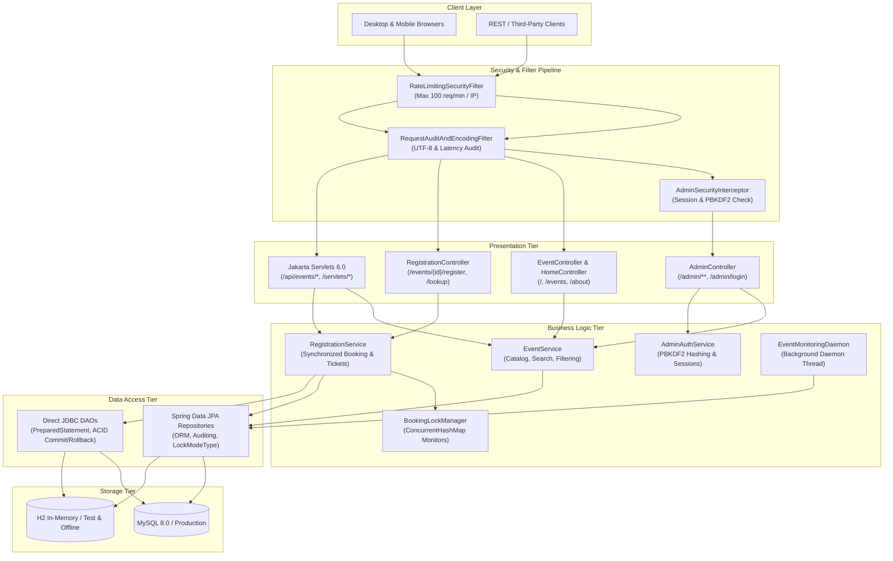

# 🎟️ EventHub — Production-Grade Event Management System

[](https://openjdk.org/)
[](https://spring.io/projects/spring-boot)
[](https://jakarta.ee/specifications/servlet/)
[](https://docs.oracle.com/javase/tutorial/jdbc/)
[](https://junit.org/junit5/)
[](https://en.wikipedia.org/wiki/PBKDF2)
[](LICENSE)

A hardened, high-concurrency event registration and organizer management system engineered with **Java 21**, **Spring Boot 3**, **Jakarta Servlet API 6.0**, **Direct JDBC**, and **Spring Data JPA**. Designed for real-world academic evaluation and portfolio demonstration, demonstrating robust concurrency control, defense-in-depth security, dual-mode data access, and automated testing.

---

## 📌 Problem Statement & Architectural Solutions

| Challenge | Architectural Vulnerability | EventHub Hardened Solution |
| :--- | :--- | :--- |
| **Last-Seat Overbooking** | Race condition between read check and transaction commit | **Per-Event Synchronized Monitors** wrapping programmatic `TransactionTemplate` commits + `SELECT ... FOR UPDATE` row locks |
| **Duplicate Registrations** | Inconsistent casing and simultaneous requests | **Case-Insensitive Normalization** (`SecuritySanitizer.normalizeEmail`) + Database Composite Unique Constraint (`uq_event_email`) |
| **Unauthorized Admin Access** | Unprotected privileged routes | **PBKDF2-HMAC-SHA512 Auth** (120,000 iterations, 16B salt, constant-time compare) + `AdminSecurityInterceptor` route guard |
| **Spreadsheet Injection** | Malicious formulas in CSV attendee rosters | **DDE Defense (CWE-1236)** prefixing formula tokens (`=`, `+`, `-`, `@`, `\t`, `\r`) with single quotes (`'`) |
| **XSS & Injection Attacks** | Unsanitized attendee profile inputs | **Sanitization Layer** stripping tags and encoding dangerous HTML characters across all registration endpoints |
| **DoS & Request Flooding** | Rapid programmatic form submissions | **Sliding-Window Rate Limiter** (`RateLimitingSecurityFilter`) throttling client IPs exceeding 100 req/min |

---

## 🏗️ System Architecture & Layered Workflow



---

## 🔐 Security Architecture & Hardening

### 1. Administrative Authentication & PBKDF2 Password Hashing
Privileged administrative actions (event creation, attendee rosters, event deletion, CSV exports) are strictly gated:
* **Algorithm:** PBKDF2 with HMAC-SHA512, 120,000 iterations, and a cryptographically secure 16-byte random salt.
* **Timing-Attack Resistance:** Employs constant-time byte comparison (`MessageDigest.isEqual`) to defeat side-channel timing analysis.
* **Interceptor Guard (`AdminSecurityInterceptor`):** Automatically intercepts all `/admin/**` endpoints, redirecting unauthorized traffic to `/admin/login?redirect=...`.
* **Configurable Credentials:** Defaults to demo credentials while allowing override via external environment variables:
  ```properties
  app.admin.username=admin
  app.admin.password=AdminPassword123!
  ```

### 2. CSV Formula Injection Defense (CWE-1236 / DDE)
When attendee rosters are exported to CSV via `ParticipantCsvExportServlet`, every user-supplied string is sanitized. If any field starts with dangerous formula execution characters (`=`, `+`, `-`, `@`, `\t`, `\r`), it is escaped with a leading single quote (`'`), preventing remote code execution when opened in Microsoft Excel or LibreOffice Calc.

### 3. Concurrency Protection & Transaction Safety
To prevent overbooking when multiple users compete for the final seat:
1. **Monitor Locking:** `RegistrationService` obtains a dedicated mutex object from `BookingLockManager` keyed to the specific `eventId`.
2. **Transaction Scoping:** The database transaction is executed inside the mutex using Spring's programmatic `TransactionTemplate`. The transaction commits **before** releasing the mutex monitor.
3. **Pessimistic Locking & Database Constraints:** Supported via JPA `@Lock(LockModeType.PESSIMISTIC_WRITE)` and `SELECT ... FOR UPDATE` in Direct JDBC.

---

## 🚀 Key Feature Highlights

### 1. Jakarta Servlet API 6.0 Integration
* **RESTful JSON API Servlet (`EventJsonApiServlet`):** Pure servlet mapped at `/api/events/*` supporting `GET` (search, category filtering, ID lookup) and `POST` (JSON attendee booking) returning standard HTTP status codes (`200 OK`, `201 Created`, `400 Bad Request`, `409 Conflict`).
* **Asynchronous SSE Capacity Stream (`LiveCapacitySseServlet`):** Uses Servlet 3.0+ Asynchronous API (`request.startAsync()`) to hold connections open and push real-time Server-Sent Events (`text/event-stream`) to browsers without page reloads.
* **Dynamic Vector SVG QR Badge (`TicketBadgeQrServlet`):** Dedicated servlet streaming crisp, scannable SVG QR codes (`image/svg+xml`) generated deterministically from ticket reference codes.
* **Native CSV Document Stream (`ParticipantCsvExportServlet`):** Authenticated `HttpServlet` streaming attendee rosters as downloadable CSV files with `Content-Disposition` headers and RFC-4180 escaping.
* **Security & Auditing Filters (`RateLimitingSecurityFilter`, `RequestAuditAndEncodingFilter`):** In-memory sliding window rate limiter (HTTP 429 Too Many Requests) and execution time audit logger.
* **Session Lifecycle Listener (`AppSessionListener`):** Atomic tracking of active user sessions in the servlet container.

### 2. Dual Data Access: Direct JDBC + Spring Data JPA
* **Direct JDBC DAOs (`EventJdbcDao`, `RegistrationJdbcDao`):** Bypasses ORM overhead using raw `java.sql.Connection`, `PreparedStatement`, and `ResultSet`.
* **Explicit ACID Transactions:** Employs `conn.setAutoCommit(false)`, `conn.commit()`, and `conn.rollback()` to guarantee atomicity when validating seats, checking duplicates, and saving attendee records.
* **Raw SQL Analytics (`EventAnalyticsDao`):** High-speed aggregation queries calculating capacity utilization percentages, remaining seats, and category metrics.

---

## 🛠️ Tech Stack

| Layer | Technology | Purpose |
| :--- | :--- | :--- |
| **Language** | Java 21 (LTS) | Modern Java core with records, pattern matching, and sealed types |
| **Framework** | Spring Boot 3.2.5 | Web MVC, dependency injection, and application lifecycle |
| **Servlet Tier** | Jakarta Servlet API 6.0 | Custom HttpServlets, Async SSE, Filters, and Session Listeners |
| **Database Access** | Direct JDBC DAO + Spring Data JPA | Raw SQL PreparedStatement transactions alongside JPA ORM |
| **Database** | MySQL 8.0 / MariaDB & In-Memory H2 | Production database with zero-setup in-memory testing profile |
| **Security** | PBKDF2-HMAC-SHA512 + Session Auth | Custom password hashing, route interceptors, and CSRF protection |
| **Testing** | JUnit 5 + AssertJ + MockMvc | Automated unit, integration, security, and concurrency stress tests |
| **Frontend** | Thymeleaf 3 + Bootstrap 5.3 | Dynamic server-side rendering with responsive modern styling |
| **Build Tool** | Apache Maven 3.9 | Build lifecycle, dependency management, and test execution |

---

## 📂 Project Directory Structure

```
event-management-system/
├── .github/
│   └── workflows/
│       └── maven.yml                        # GitHub Actions CI workflow (Java 21, test & package)
├── database/
│   └── event_db.sql                         # MySQL schema script and sample seed data
├── src/main/java/com/eventhub/
│   ├── EventManagementApplication.java      # Spring Boot entry point & seed runner
│   ├── concurrency/
│   │   ├── BookingLockManager.java          # Per-event synchronization monitor locks
│   │   └── EventMonitoringDaemon.java       # Background daemon thread for seat audits
│   ├── config/
│   │   ├── ServletConfig.java               # Servlet, Filter & Listener container configuration
│   │   └── WebMvcConfig.java                # Spring MVC interceptor registration
│   ├── controller/
│   │   ├── AdminController.java             # Organizer dashboard, auth routes & event CRUD
│   │   ├── EventController.java             # Public catalog & event detail views
│   │   ├── HomeController.java              # Home landing & about routes
│   │   └── RegistrationController.java      # Registration workflows & pass lookup
│   ├── dao/
│   │   ├── EventAnalyticsDao.java           # Direct JDBC DAO for occupancy reporting
│   │   ├── EventJdbcDao.java                # Direct JDBC CRUD DAO using PreparedStatement
│   │   └── RegistrationJdbcDao.java         # Transactional JDBC DAO with commit/rollback
│   ├── diagnostic/
│   │   └── SystemVerificationRunner.java    # Automated startup verification & stress test
│   ├── dto/
│   │   └── EventOccupancyDto.java           # Data transfer object for analytics metrics
│   ├── exception/
│   │   └── GlobalExceptionHandler.java      # Centralized exception interceptor (@ControllerAdvice)
│   ├── filter/
│   │   ├── RateLimitingSecurityFilter.java  # DoS protection & rate limiter (HTTP 429)
│   │   └── RequestAuditAndEncodingFilter.java # UTF-8 enforcement & execution timer filter
│   ├── listener/
│   │   └── AppSessionListener.java          # HttpSessionListener tracking active sessions
│   ├── model/
│   │   ├── Event.java                       # Event JPA entity & capacity calculations
│   │   └── Registration.java                # Registration JPA entity & composite unique constraints
│   ├── repository/
│   │   ├── EventRepository.java             # JPA queries for event filtering & counts
│   │   └── RegistrationRepository.java      # JPA queries for duplicate checks & tickets
│   ├── security/
│   │   ├── AdminAuthService.java            # Session auth manager with PBKDF2 validation
│   │   ├── AdminSecurityInterceptor.java    # HandlerInterceptor enforcing admin authentication
│   │   └── PasswordHasher.java              # Cryptographic PBKDF2-HMAC-SHA512 password hasher
│   ├── service/
│   │   ├── EventService.java                # Business logic for events & search
│   │   └── RegistrationService.java         # Synchronized booking logic & ticket generator
│   ├── servlet/
│   │   ├── EventJsonApiServlet.java         # Pure RESTful JSON API Servlet (/api/events/*)
│   │   ├── EventListServlet.java            # Pure HttpServlet event catalog with session tracking
│   │   ├── EventRegistrationServlet.java    # Pure HttpServlet registration with JDBC transactions
│   │   ├── LiveCapacitySseServlet.java      # Asynchronous Servlet streaming SSE capacity updates
│   │   ├── ParticipantCsvExportServlet.java # Secure HttpServlet streaming CSV attendee rosters
│   │   └── TicketBadgeQrServlet.java        # Dedicated servlet streaming Vector SVG QR Badges
│   └── util/
│       └── SecuritySanitizer.java           # XSS, HTML, and email normalization utility
├── src/main/resources/
│   ├── application.properties               # MySQL database configuration
│   ├── application-h2.properties            # In-memory H2 profile (for zero-setup testing)
│   ├── static/                              # CSS stylesheets, JS filters, assets
│   └── templates/                           # Thymeleaf HTML5 templates
│       ├── index.html                       # Homepage
│       ├── events.html                      # Event catalog with search & filters
│       ├── event-details.html               # Single event overview & venue info
│       ├── register.html                    # Registration form
│       ├── registration-success.html        # Pass page with dynamic SVG QR badge
│       ├── lookup.html                      # Ticket lookup with QR verification
│       ├── error.html                       # Friendly error page (400, 403, 404, 500)
│       └── admin/                           # Organizer dashboard, forms & login view
├── src/test/java/com/eventhub/
│   ├── concurrency/
│   │   └── ConcurrencyBookingIntegrationTest.java # Multithreaded 10-thread capacity test
│   ├── controller/
│   │   ├── AdminSecurityIntegrationTest.java      # Admin auth, login, logout, 403 checks
│   │   └── EventControllerIntegrationTest.java    # Catalog, search, and lookup view tests
│   ├── security/
│   │   └── SecurityAndValidationTest.java         # PBKDF2, salt, XSS, email, CSV injection tests
│   ├── service/
│   │   ├── EventServiceTest.java                  # Event business logic unit tests
│   │   └── RegistrationServiceTest.java           # Booking & duplicate prevention unit tests
│   └── servlet/
│       └── ServletDirectIntegrationTest.java      # Native HttpServlet GET/POST & CSV export tests
├── pom.xml                                  # Maven dependencies & build configuration
├── run.bat                                  # 1-Click launcher (MySQL mode)
├── run-h2.bat                               # 1-Click launcher (H2 zero-setup mode)
└── LICENSE                                  # MIT License
```

---

## ⚡ Getting Started

### 1. Prerequisites
Ensure the following tools are installed and accessible from your terminal (`PATH`):
* **Java 21** (or Java 17+):
  ```bash
  java -version
  ```
* **Apache Maven** (3.8+):
  ```bash
  mvn -version
  ```
* *(Optional for MySQL mode)* **MySQL Server 8.0+** running on port `3306`. If you do not have MySQL installed, you can run the zero-setup H2 in-memory mode without installing anything.

---

### 2. Running the Application

Choose **one** of the two modes below:

#### Option A: Quick Start with In-Memory H2 (No Database Setup Needed)
Starts the application immediately using the built-in in-memory database with pre-seeded demo events.

**Windows / macOS / Linux:**
```bash
mvn spring-boot:run -Dspring-boot.run.arguments=--spring.profiles.active=h2
```
*(Windows users can also double-click `run-h2.bat`)*

#### Option B: Standard Start with MySQL Database
1. Make sure your MySQL server is running on port `3306`.
2. Create the database:
   ```sql
   CREATE DATABASE event_db;
   ```
3. If your MySQL credentials differ from `root` with a blank password, update them in `src/main/resources/application.properties`.
4. Start the application:
   ```bash
   mvn spring-boot:run
   ```
   *(Windows users can also double-click `run.bat`)*

---

### 3. Accessing the Application in Your Browser
Once the terminal displays `Started EventManagementApplication`, open your web browser:
* **Public Event Portal:** [http://localhost:8080](http://localhost:8080)
* **Organizer Admin Console:** [http://localhost:8080/admin](http://localhost:8080/admin) *(Sign in using default credentials below)*
* **H2 Database Console:** [http://localhost:8080/h2-console](http://localhost:8080/h2-console) *(H2 mode only — JDBC URL: `jdbc:h2:mem:event_db`, User: `sa`, Password: empty)*

### 4. Stopping the Application
To stop the running application, press `Ctrl + C` in your terminal window.

---

## 🔑 Default Administrator Credentials

When accessing the organizer control console at `/admin`, log in with:

| Parameter | Default Value | Notes |
| :--- | :--- | :--- |
| **Username** | `admin` | Case-insensitive |
| **Password** | `AdminPassword123!` | Hashed with PBKDF2-HMAC-SHA512 at startup |

*You can configure custom credentials via `app.admin.username` and `app.admin.password` in `application.properties` or via environment variables `ADMIN_USERNAME` and `ADMIN_PASSWORD`.*

---

## 🌐 Application Endpoints & Routes

| Route | Type | Authentication | Description |
| :--- | :--- | :--- | :--- |
| `GET /` | MVC | Public | Landing homepage with metrics and featured events |
| `GET /events` | MVC | Public | Event catalog with keyword search and category filtering |
| `GET /events/{id}` | MVC | Public | Detailed event page with seat count and organizer info |
| `GET /events/{id}/register` | MVC | Public | Attendee booking form with validation |
| `POST /events/{id}/register` | MVC | Public | Submits registration with synchronized lock & email check |
| `GET /registrations/lookup` | MVC | Public | Admission ticket lookup by reference code |
| `GET /admin/login` | MVC | Public | Dedicated organizer login portal |
| `POST /admin/login` | MVC | Public | Authenticates admin credentials using PBKDF2 |
| `GET /admin/logout` | MVC | Admin | Terminates session and redirects to login |
| `GET /admin` | MVC | Admin | Organizer control console with live event health |
| `GET /admin/events/new` | MVC | Admin | Create a new event listing |
| `POST /admin/events/delete/{id}` | MVC | Admin | Safely deletes an event with confirmation |
| `GET /admin/events/{id}/participants`| MVC | Admin | Attendee roster with seat release action |
| `GET /api/events` | Servlet API | Public | JSON list of active events via `EventJsonApiServlet` |
| `GET /api/events/{id}` | Servlet API | Public | JSON details for a specific event |
| `POST /api/events` | Servlet API | Public | JSON attendee booking via REST API servlet |
| `GET /servlets/export-csv?eventId={id}`| Servlet API | Admin | Secure CSV participant roster download with DDE defense |
| `GET /servlets/live-capacity` | Async Servlet | Public | Real-time Server-Sent Events (SSE) capacity stream |
| `GET /servlets/ticket-badge?code={code}`| Servlet API| Public | Dynamic Vector SVG QR Code admission badge |

---

## 🧪 Automated Testing Suite (JUnit 5)

The project includes an automated test suite with **31 automated tests** covering unit, integration, security, and concurrency scenarios.

### Running All Tests
```bash
mvn test
```

### Packaging the Application
To build a standalone executable JAR in `target/`:
```bash
mvn clean package
```

### Test Coverage Summary:
* `SecurityAndValidationTest` (5 tests): PBKDF2-HMAC-SHA512 hashing, salt uniqueness, XSS input defense, email normalization, and CSV formula injection defense (DDE CWE-1236).
* `EventServiceTest` (5 tests): Catalog retrieval, event creation, search and category filtering, ID lookup, and deletion.
* `RegistrationServiceTest` (5 tests): Atomic booking, duplicate email rejection, capacity overflow prevention, closed event rejection, and cancellation with seat release.
* `AdminSecurityIntegrationTest` (6 tests): Route interception on unauthenticated access, valid admin login, invalid credential rejection, authenticated dashboard access, and secure logout.
* `EventControllerIntegrationTest` (5 tests): Web MVC routes, Thymeleaf view rendering, category filters, and ticket lookup.
* `ServletDirectIntegrationTest` (4 tests): Native `HttpServlet` direct tests verifying unauthenticated 403 rejection, CSV headers and DDE defense, and REST JSON API endpoints.
* `ConcurrencyBookingIntegrationTest` (1 test): High-concurrency stress test with 10 simultaneous threads competing for 3 seats, verifying exact capacity preservation and zero overbooking.

---

## 📄 License

This project is open-source and licensed under the [MIT License](LICENSE).
