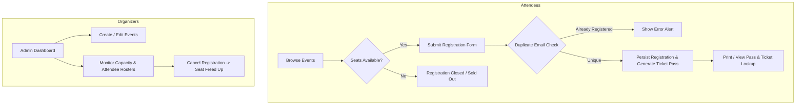

# 🎟️ EventHub — Centralized Event Management System

[](https://openjdk.org/)
[](https://spring.io/projects/spring-boot)
[](https://www.thymeleaf.org/)
[](https://www.mysql.com/)
[](LICENSE)

A modern, full-stack web platform built with **Java 21** and **Spring Boot 3** designed to unify event planning, attendee registration, live capacity tracking, and participant management into one centralized system.

---

## 📌 Problem Statement

Managing events through fragmented Google Forms, direct messaging channels, and manual spreadsheets presents significant operational challenges:
* ⚠️ **Duplicate Registrations:** Attendees register multiple times, inflating headcounts and skewing planning metrics.
* ⚠️ **Communication Gaps & Lost Tickets:** Participants lack immediate, verifiable admission passes or lookup tools.
* ⚠️ **Accidental Overbooking:** Manual sign-up forms cannot enforce live seat capacity constraints.
* ⚠️ **Inefficient Participant Tracking:** Organizers struggle to retrieve rosters, inspect remaining seats, or manage cancellations centrally.

---

## 💡 The Solution

**EventHub** replaces ad-hoc forms with a unified web platform:
1. **Centralized Event Portal:** Attendees discover events, search by keyword, filter by category, and view real-time seat availability.
2. **Duplicate Prevention Engine:** Enforces case-insensitive email uniqueness per event at both the service layer (`existsByEventIdAndEmailIgnoreCase`) and database layer (`UNIQUE KEY uq_event_email`).
3. **Live Seat & Capacity Controls:** Real-time capacity validation prevents registrations once an event is sold out, complete with visual utilization progress bars.
4. **Unique Admission Pass Generation:** Generates tamper-resistant, human-readable ticket codes (`EVT-2026-XXXXX`) with printable e-passes and instant online reference lookup.
5. **Organizer Control Console:** Administrative dashboard to create, update, and delete events, view live attendee rosters, and cancel registrations to immediately free up seats.

---

## 🚀 Key Features

### 👤 For Attendees
* 🔍 **Browse & Filter:** Explore upcoming events with search by title/description and category filtering (Technical, Workshop, Cultural, Sports, Seminar).
* 📝 **Streamlined Registration:** Fast signup form with validation for names, phone numbers, and emails.
* 🛡️ **Anti-Duplicate Check:** Rejects duplicate submissions from the same email for the same event.
* 🎫 **Digital Admission Pass:** Generates a clean, printable confirmation pass displaying event details and unique ticket reference.
* 🔎 **Ticket Lookup Portal:** Attendees can search and verify their registration pass anytime using their reference code.

### 🛠️ For Organizers & Admins
* 📊 **Live Analytics Dashboard:** Total events, upcoming events count, aggregate attendees, and capacity fill percentages.
* ✏️ **Full Event Lifecycle (CRUD):** Create new events, edit dates/venues/capacities, or archive events.
* 👥 **Participant Management:** Searchable attendee rosters per event with one-click registration cancellation.
* 🔒 **Capacity Protection:** Visual badges (`Seats Left`, `Sold Out`) and automated registration lockout when limits are reached.

---

## 🛠️ Tech Stack

| Layer | Technology | Purpose |
| :--- | :--- | :--- |
| **Language** | Java 21 (LTS) | Modern Java core with records and enhanced pattern matching |
| **Framework** | Spring Boot 3.2.5 | Web MVC, dependency injection, and application lifecycle |
| **Persistence** | Spring Data JPA / Hibernate | Object-Relational Mapping (ORM) and repository query generation |
| **Database** | MySQL 8.0 / MariaDB | Production relational database (with zero-setup H2 in-memory option) |
| **Validation** | Jakarta Bean Validation | Declarative constraint annotations (`@NotBlank`, `@Email`, `@Min`) |
| **Frontend** | Thymeleaf 3 + Bootstrap 5.3 | Dynamic server-side rendering with responsive modern styling |
| **Build Tool** | Apache Maven 3.9 | Dependency management and packaging (Maven Wrapper included) |

---

## 🏗️ System Architecture & Workflow



---

## 📂 Project Directory Structure

```
event-management-system/
├── database/
│   └── event_db.sql                         # MySQL schema script and sample seed data
├── src/main/java/com/eventhub/
│   ├── EventManagementApplication.java      # Spring Boot entry point & seed runner
│   ├── model/
│   │   ├── Event.java                       # Event JPA entity & capacity calculations
│   │   └── Registration.java                # Registration JPA entity & unique constraints
│   ├── repository/
│   │   ├── EventRepository.java             # JPA queries for event filtering & counts
│   │   └── RegistrationRepository.java      # JPA queries for duplicate check & tickets
│   ├── service/
│   │   ├── EventService.java                # Business logic for events & search
│   │   └── RegistrationService.java         # Registration logic, seat checks, tickets
│   └── controller/
│       ├── HomeController.java              # Home landing & about routes
│       ├── EventController.java             # Public catalog & event detail routes
│       ├── RegistrationController.java      # Registration workflows & pass lookup
│       └── AdminController.java             # Organizer dashboard & event CRUD
├── src/main/resources/
│   ├── application.properties               # MySQL database configuration
│   ├── application-h2.properties            # In-memory H2 profile (for zero-setup testing)
│   ├── static/                              # CSS stylesheets, JS filters, assets
│   └── templates/                           # Thymeleaf HTML5 templates
│       ├── index.html                       # Homepage
│       ├── events.html                      # Event catalog with search & filters
│       ├── event-details.html               # Single event overview & venue info
│       ├── register.html                    # Registration form
│       ├── registration-success.html        # Printable ticket pass
│       ├── lookup.html                      # Ticket lookup & verification
│       ├── about.html                       # Platform overview & architecture
│       ├── fragments/                       # Reusable header and footer components
│       └── admin/                           # Organizer dashboard & forms
├── pom.xml                                  # Maven dependencies & build configuration
├── run.bat                                  # 1-Click launcher (MySQL mode)
├── run-h2.bat                               # 1-Click launcher (H2 zero-setup mode)
└── .gitignore                               # Standard Git ignore rules
```

---

## 🗄️ Database Schema & Relational Integrity

```
               ┌─────────────────────────────┐
               │           events            │
               ├─────────────────────────────┤
               │ id (PK, BIGINT, AUTO_INC)   │
               │ title (VARCHAR 150)         │
               │ category (VARCHAR 50)       │
               │ description (TEXT)          │
               │ event_date (DATETIME)       │
               │ venue (VARCHAR 150)         │
               │ capacity (INT)              │
               │ organizer_name (VARCHAR 100)│
               │ organizer_email (VARCHAR 100│
               │ organizer_phone (VARCHAR 20)│
               │ banner_url (VARCHAR 255)    │
               │ status (VARCHAR 20)         │
               │ created_at (TIMESTAMP)      │
               └──────────────┬──────────────┘
                              │ 1
                              │
                              │ has many
                              │
                              │ *
               ┌──────────────▼──────────────┐
               │        registrations        │
               ├─────────────────────────────┤
               │ id (PK, BIGINT, AUTO_INC)   │
               │ registration_code (UQ)      │
               │ event_id (FK -> events.id)  │
               │ participant_name (VARCHAR)  │
               │ email (VARCHAR 100)         │
               │ phone (VARCHAR 20)          │
               │ organization (VARCHAR 100)  │
               │ role_title (VARCHAR 50)     │
               │ special_notes (TEXT)        │
               │ registration_date (TIMESTMP)│
               └─────────────────────────────┘
               * COMPOSITE UNIQUE KEY: (event_id, email)
```

---

## ⚡ Getting Started

### 1. Prerequisites
* **Java 21** (or Java 17+) installed:
  ```bash
  java -version
  ```
* **Git** installed on your machine.

---

### 2. Clone the Repository
```bash
git clone https://github.com/YOUR_USERNAME/event-management-system.git
cd event-management-system
```

---

### 3. Running the Application

You can run the application in either of two modes:

#### Option A: Zero-Configuration Mode (Built-in H2 In-Memory DB)
No MySQL installation required. Runs instantly with pre-seeded sample events:
```bash
# Windows
.\run-h2.bat

# Or using Maven wrapper
.\mvnw.cmd spring-boot:run "-Dspring-boot.run.arguments=--spring.profiles.active=h2"

# Linux / macOS
./mvnw spring-boot:run -Dspring-boot.run.arguments=--spring.profiles.active=h2
```

#### Option B: MySQL Database Mode
1. Start MySQL (via XAMPP, Docker, or native service) on port `3306`.
2. Create the database:
   ```sql
   CREATE DATABASE event_db;
   ```
3. Update `src/main/resources/application.properties` if your password differs:
   ```properties
   spring.datasource.url=jdbc:mysql://localhost:3306/event_db?useSSL=false&serverTimezone=UTC&allowPublicKeyRetrieval=true&createDatabaseIfNotExist=true
   spring.datasource.username=root
   spring.datasource.password=
   ```
4. Start the application:
   ```bash
   # Windows
   .\run.bat

   # Or using Maven wrapper
   .\mvnw.cmd spring-boot:run
   ```

---

## 🌐 Application URLs

| Route | Functionality |
| :--- | :--- |
| `http://localhost:8080/` | Public homepage with featured events and platform statistics |
| `http://localhost:8080/events` | Event catalog with search bar and category filters |
| `http://localhost:8080/events/{id}` | Detailed event view with venue, organizer details, and seats left |
| `http://localhost:8080/events/{id}/register` | Participant registration form with capacity and email checks |
| `http://localhost:8080/registrations/lookup` | Ticket code verification and pass retrieval portal |
| `http://localhost:8080/admin` | Administrative console for event CRUD and attendee management |
| `http://localhost:8080/admin/analytics` | Direct JDBC DAO live occupancy analytics (`EventAnalyticsDao`) |
| `http://localhost:8080/admin/events/new` | Create a new event listing |
| `http://localhost:8080/admin/events/{id}/participants` | Live attendee roster and registration cancellation |
| `http://localhost:8080/export/participants.csv?eventId=1` | CSV download streamed via `ParticipantCsvExportServlet` |
| `http://localhost:8080/servlets/events` | Pure `HttpServlet` event catalog with session tracking (`EventListServlet`) |
| `http://localhost:8080/servlets/register?eventId=1` | Pure `HttpServlet` registration with raw JDBC transaction (`EventRegistrationServlet`) |

---

## 🤝 Contributing

Contributions are always welcome!
1. Fork the repository
2. Create your feature branch (`git checkout -b feature/AmazingFeature`)
3. Commit your changes (`git commit -m 'Add some AmazingFeature'`)
4. Push to the branch (`git push origin feature/AmazingFeature`)
5. Open a Pull Request

---

## 📄 License

This project is open-source and licensed under the [MIT License](LICENSE).
